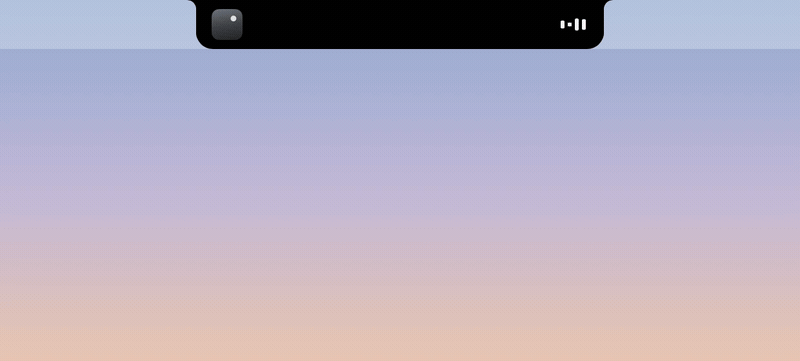
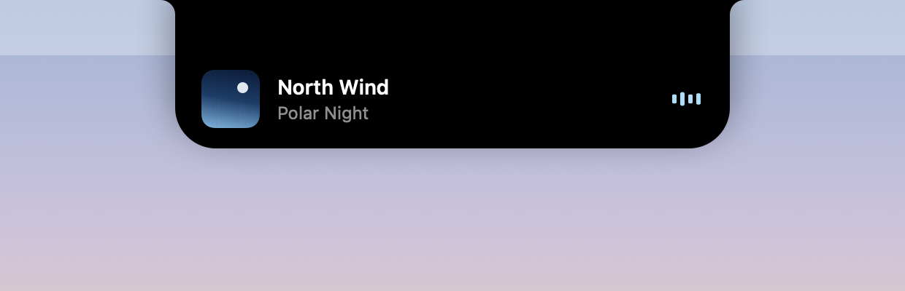

# Monobrow

Spotify player for the MacBook notch.

[](https://github.com/rbnmssno/Monobrow/actions/workflows/build.yml) · [Русская версия](#по-русски)



While a song plays, the album cover sits to the left of the camera and a small equalizer to the right. Hover the notch and it opens into a player with seeking, volume, skip and like. Monobrow shows up when you open Spotify and hides when you quit it.

| Collapsed | Track change | Liked |
|---|---|---|
|  |  |  |

## Download

[Monobrow.dmg](https://github.com/rbnmssno/Monobrow/releases/latest/download/Monobrow.dmg) for macOS 14 or later on Apple silicon.

The first launch needs to be allowed by hand once:

1. Open the disk image and drag Monobrow to Applications.
2. Open Monobrow. macOS refuses to run it; click Done.
3. Go to System Settings → Privacy & Security, scroll down and click Open Anyway next to the Monobrow message.
4. When macOS asks whether Monobrow may control Spotify, allow it.

Instead of steps 2 and 3 you can clear the quarantine flag in Terminal:

```
xattr -dr com.apple.quarantine /Applications/Monobrow.app
```

## Features

- Cover, title and artist; long titles scroll
- Play/pause, previous/next, seek, volume, mute
- Like with the heart or by double-clicking the cover
- Shows the new track for a moment when it changes
- Folds back into the notch ten seconds after you pause
- Works on displays without a notch, hanging from the top edge
- Opens at login and waits for Spotify; the Dock icon is optional
- English or Russian, following the system language

## How it works

Monobrow doesn't poll Spotify. Spotify posts a distributed notification (`com.spotify.client.PlaybackStateChanged`) on every play, pause, seek and track change, and the app sleeps in between. Commands go to Spotify as raw Apple Events built from the codes in its scripting dictionary, so there's no AppleScript to compile and Spotify never gets launched by accident.

The equalizer, the progress bar and the scrolling title are Core Animation animations. The window server draws them, the app does no work per frame, and an open player sits at 0% CPU.

The island is a transparent, non-activating panel above the menu bar. It never takes keyboard focus, and clicks on anything it doesn't draw go through to the windows below.

Likes use the Spotify Web API. Login is the authorization code flow with PKCE and a loopback redirect, so there's no client secret, and the refresh token is kept in the Keychain.

Measured with `footprint` and `top` on an Apple silicon MacBook Pro:

| | Memory | CPU |
|---|---|---|
| Waiting for Spotify | 11 MB | 0% |
| Collapsed, equalizer moving | 19 MB | 0% |
| Player open, title scrolling | ~23 MB | 0% |

Opening Settings adds about 17 MB until the next restart.

## Likes

Liking goes through the Spotify Web API, which needs a (free) app of your own in Spotify's developer dashboard and a Premium account.

1. Create an app in the [Spotify developer dashboard](https://developer.spotify.com/dashboard).
2. Add `http://127.0.0.1:43917/callback` as a redirect URI and select Web API.
3. Paste the Client ID into Monobrow's settings (right-click the island → Settings) and click Connect.

## Building

You need Xcode or the Command Line Tools with Swift 5.9 or later.

```
scripts/build.sh
```

This makes `dist/Monobrow.app` and `dist/Monobrow.dmg`. A copy you build yourself opens without the Gatekeeper step.

The icon is an Icon Composer file, `Resources/AppIcon.icon`. With Xcode 26 or later the build compiles it, so macOS draws it with the system's glass and in the light or dark icon style; without Xcode the prebuilt `Resources/AppIcon.icns` is used.

Development switches, none of which touch your real Spotify or your settings:

```
Monobrow --selftest        # 195 checks against a simulated player, clicking the real buttons
Monobrow --demo            # the island with made-up tracks
Monobrow --snapshots DIR   # a PNG of every state (add --backdrop for README-style images)
Monobrow --tour            # the scripted walkthrough the GIF above was recorded from
Monobrow --stress          # many open/close cycles and track changes, logging memory
```

The binary is `dist/Monobrow.app/Contents/MacOS/Monobrow`. Add `-AppleLanguages '(en)'` or `'(ru)'` to pick the language.

| Folder | What's there |
|---|---|
| `Sources/Monobrow/Spotify` | Notifications, Apple Events, cover loading, the simulated player |
| `Sources/Monobrow/Model` | Player state and the island's behaviour |
| `Sources/Monobrow/Island` | The panel and its views |
| `Sources/Monobrow/Account` | Spotify login and likes |
| `Sources/Monobrow/Settings` | Settings window, launch at login |
| `Sources/Monobrow/Dev` | Self-test, snapshots, tour, stress test |

## Uninstalling

```
/Applications/Monobrow.app/Contents/MacOS/Monobrow --uninstall
```

This removes the login item, the saved Spotify login and the settings. Then delete the app.

## По-русски

Monobrow — плеер Spotify в вырезе MacBook. Пока играет музыка, слева от камеры видна обложка, справа эквалайзер. Наведи курсор на вырез, и откроется плеер с перемоткой, громкостью, переключением треков и лайком. Monobrow появляется, когда открываешь Spotify, и прячется, когда его закрываешь. Язык интерфейса берётся из системы.

### Установка

[Скачать Monobrow.dmg](https://github.com/rbnmssno/Monobrow/releases/latest/download/Monobrow.dmg). Нужна macOS 14 или новее на Apple silicon.

Первый запуск нужно один раз разрешить вручную:

1. Открой образ и перетащи Monobrow в «Программы».
2. Запусти Monobrow. macOS откажется его открывать, нажми «Готово».
3. Открой «Системные настройки» → «Конфиденциальность и безопасность», прокрути вниз и нажми «Всё равно открыть» рядом с сообщением о Monobrow.
4. Когда macOS спросит, можно ли Monobrow управлять Spotify, разреши.

Вместо шагов 2 и 3 можно снять карантин в Терминале:

```
xattr -dr com.apple.quarantine /Applications/Monobrow.app
```

### Лайки

Лайки идут через Spotify Web API. Для этого нужно своё бесплатное приложение в кабинете разработчика Spotify и Premium.

1. Создай приложение в [Spotify for Developers](https://developer.spotify.com/dashboard).
2. Добавь Redirect URI `http://127.0.0.1:43917/callback` и отметь Web API.
3. Вставь Client ID в настройки Monobrow (правый клик по острову → «Настройки») и нажми «Подключить».

### Как устроено

Monobrow не опрашивает Spotify по таймеру. Spotify сам присылает системное уведомление при каждой паузе, перемотке и смене трека, а между ними приложение спит. Команды уходят в Spotify через Apple Events, без AppleScript. Эквалайзер, полоску прогресса и бегущую строку рисует Core Animation, поэтому даже открытый плеер не нагружает процессор. В ожидании Spotify приложение занимает 11 МБ памяти, с островом около 20 МБ.

Сборка из исходников, режимы для разработки и удаление описаны выше в английской части.

---

Monobrow is a personal project, not affiliated with Spotify. [MIT license](LICENSE).
