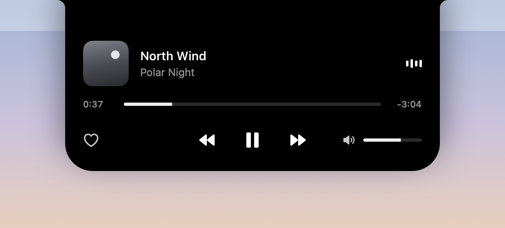
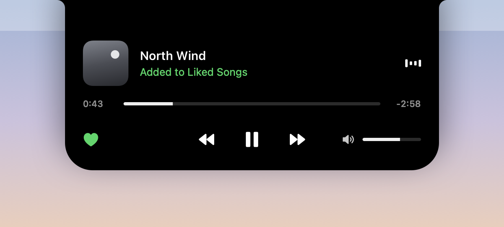

# Monobrow

A Spotify player that lives in the MacBook notch.



[Русская версия ниже](#monobrow-по-русски)

Monobrow turns the notch into a small island, in the spirit of the iPhone's Dynamic Island. While music plays, the cover sits to the left of the camera and an equalizer to the right. Hover the notch and the island opens into a player. It starts together with Spotify and goes away with it.

| Collapsed | New track | Like |
|---|---|---|
|  |  |  |

The screenshots show the built-in demo mode with made-up tracks.

## Download

[**Download Monobrow.dmg**](https://github.com/rbnmssno/Monobrow/releases/latest/download/Monobrow.dmg) — macOS 14 or later, Apple silicon.

1. Open the disk image and drag Monobrow to Applications.
2. Launch Monobrow. The first time, macOS refuses to open it: the app is signed locally and not notarized by Apple, which would need a paid developer account. Click Done.
3. Open System Settings, go to Privacy & Security, scroll down to Security and click Open Anyway next to the message about Monobrow. Confirm.
4. When macOS asks whether Monobrow may control Spotify, allow it.

Step 3 is needed only once. If you prefer the Terminal, this command does the same by removing the "downloaded from the internet" mark:

```
xattr -dr com.apple.quarantine /Applications/Monobrow.app
```

## Features

- Cover, title and artist of the current track; long titles scroll.
- Play and pause, next and previous, seeking, volume and mute.
- Like and unlike, also by double-clicking the cover.
- A short announcement when the track changes.
- Folds into the notch a few seconds after you pause.
- Works on screens without a notch: the island hangs from the top edge.
- Launches at login and waits for Spotify; no Dock icon unless you want one.

## How it works

**No polling.** Spotify posts a distributed notification on every play, pause, seek and track change. Monobrow listens for it and does nothing in between. Commands and the few values the notification lacks go over raw Apple Events, built from the four-character codes in Spotify's scripting dictionary. No AppleScript is compiled, and Spotify is never launched by accident.

**A window that stays out of the way.** The island is a fixed-size, transparent, non-activating panel above the menu bar. It never takes keyboard focus. Everything it does not draw lets clicks through to the windows below, including its own shadow.

**Animation without CPU.** The equalizer, the progress bar and the scrolling title are Core Animation animations, so the system's render server draws them and the app does no work per frame. One-shot effects (the island's spring, the play/pause morph, the like burst) run only while you interact.

**Likes.** Liking goes through the Spotify Web API. Login is the authorization code flow with PKCE and a loopback redirect, so no client secret is involved. The refresh token is kept in the Keychain.

### Resource use

Measured with `top` and `footprint` on an Apple silicon MacBook Pro:

| State | Memory | CPU |
|---|---|---|
| Waiting for Spotify | 11 MB | 0% |
| Collapsed island, equalizer running | 19 MB | 0% |
| Open player, title scrolling | about 23 MB | 0% |

Opening the settings window adds about 17 MB until the app restarts.

## Requirements

- macOS 14 or later on Apple silicon. Developed and tested on macOS 27.
- The Spotify desktop app.
- For likes: a Spotify Premium account, because Spotify requires it for apps in development mode.

## Build from source

You need Xcode or the Command Line Tools with Swift 5.9 or later.

```
scripts/build.sh
```

This produces `dist/Monobrow.dmg`. Open it, drag Monobrow to Applications and launch it from there. A copy built on your own Mac opens without the extra confirmation described above.

### Enabling likes

1. Open the [Spotify for Developers dashboard](https://developer.spotify.com/dashboard) and create an app.
2. Add the redirect URI `http://127.0.0.1:43917/callback`.
3. Select Web API and save.
4. Copy the Client ID into Monobrow's settings (right-click the island, then Settings) and press Connect.

### Uninstalling

```
/Applications/Monobrow.app/Contents/MacOS/Monobrow --uninstall
```

This removes the login item, the saved Spotify login and the settings. Then delete the app.

## Testing

```
dist/Monobrow.app/Contents/MacOS/Monobrow --selftest          # 195 checks against a simulated player
dist/Monobrow.app/Contents/MacOS/Monobrow --demo              # the island with made-up tracks, no Spotify needed
dist/Monobrow.app/Contents/MacOS/Monobrow --snapshots <dir>   # PNG snapshots of every state
dist/Monobrow.app/Contents/MacOS/Monobrow --stress            # many open/close cycles and track changes, logging memory
```

The self-test clicks the real buttons with synthetic mouse events, checks which screen points take clicks, and runs the login flow against a stand-in server. None of these modes touch the real Spotify, and they keep their own settings.

## Project layout

| Folder | Contents |
|---|---|
| `Sources/Monobrow/Spotify` | Notifications, Apple Events, cover loading, the simulated player |
| `Sources/Monobrow/Model` | Player state and the island's behaviour |
| `Sources/Monobrow/Island` | The panel and its interface |
| `Sources/Monobrow/Account` | Spotify login and likes |
| `Sources/Monobrow/Settings` | Settings window, launch at login |
| `Sources/Monobrow/Dev` | Self-test, snapshots, stress test |

## Notes

- The interface is in Russian.
- Monobrow is a personal project. It is not affiliated with or endorsed by Spotify.

## License

[MIT](LICENSE)

---

# Monobrow по-русски

Плеер Spotify, который живёт в вырезе MacBook.

Monobrow превращает вырез в маленький остров, как Dynamic Island на iPhone. Пока играет музыка, слева от камеры видна обложка, справа эквалайзер. Наведи курсор на вырез, и остров раскроется в плеер. Он запускается вместе со Spotify и исчезает вместе с ним.

На снимках выше показан встроенный демо-режим с выдуманными треками.

## Скачать

[**Скачать Monobrow.dmg**](https://github.com/rbnmssno/Monobrow/releases/latest/download/Monobrow.dmg) — macOS 14 или новее, Apple silicon.

1. Открой образ и перетащи Monobrow в «Программы».
2. Запусти Monobrow. В первый раз macOS откажется его открыть: приложение подписано локально и не заверено Apple, для этого нужен платный аккаунт разработчика. Нажми «Готово».
3. Открой «Системные настройки», раздел «Конфиденциальность и безопасность», прокрути до блока «Безопасность» и нажми «Всё равно открыть» рядом с сообщением о Monobrow. Подтверди.
4. Когда macOS спросит, можно ли Monobrow управлять Spotify, разреши.

Шаг 3 нужен только один раз. То же самое делает команда в Терминале, она снимает с приложения отметку «загружено из интернета»:

```
xattr -dr com.apple.quarantine /Applications/Monobrow.app
```

## Возможности

- Обложка, название и артист текущего трека; длинные названия прокручиваются.
- Пауза, следующий и предыдущий трек, перемотка, громкость и выключение звука.
- Лайк и его снятие, в том числе двойным кликом по обложке.
- Короткий показ названия при смене трека.
- Через несколько секунд после паузы остров уходит в вырез.
- Работает и на экранах без выреза: остров висит у верхнего края.
- Стартует при входе в систему и ждёт Spotify; значка в Dock нет, если он не нужен.

## Как это устроено

**Без опросов.** Spotify сам рассылает системное уведомление при каждой паузе, перемотке и смене трека. Monobrow слушает его и между событиями ничего не делает. Команды и недостающие значения идут через Apple Events, собранные по кодам из словаря сценариев Spotify. AppleScript не компилируется, и Spotify не запускается случайно.

**Окно, которое не мешает.** Остров — прозрачная панель фиксированного размера поверх строки меню. Она никогда не забирает фокус клавиатуры. Всё, что остров не рисует, пропускает клики к окнам под ним, включая его собственную тень.

**Анимации без нагрузки.** Эквалайзер, полоску прогресса и бегущее название анимирует Core Animation: их рисует системный сервер отрисовки, а приложение не работает на каждом кадре. Разовые эффекты (пружина острова, превращение паузы в плей, искры лайка) идут только в момент взаимодействия.

**Лайки.** Лайк ставится через Spotify Web API. Вход сделан по схеме authorization code с PKCE и локальным адресом возврата, без секретного ключа. Токен обновления хранится в Связке ключей.

### Ресурсы

Замеры `top` и `footprint` на MacBook Pro с Apple silicon:

| Состояние | Память | Процессор |
|---|---|---|
| Ждёт Spotify | 11 МБ | 0% |
| Свёрнутый остров, эквалайзер работает | 19 МБ | 0% |
| Открытый плеер, название прокручивается | около 23 МБ | 0% |

Окно настроек добавляет около 17 МБ до перезапуска приложения.

## Требования

- macOS 14 или новее, Apple silicon. Разрабатывался и проверялся на macOS 27.
- Приложение Spotify для Mac.
- Для лайков нужен Spotify Premium: этого требует Spotify от приложений в режиме разработки.

## Сборка из исходников

Нужен Xcode или Command Line Tools со Swift 5.9 или новее.

```
scripts/build.sh
```

Получится `dist/Monobrow.dmg`. Открой его, перетащи Monobrow в «Программы» и запусти оттуда. Копия, собранная на своём Mac, открывается без дополнительного подтверждения, описанного выше.

### Как включить лайки

1. Открой [Spotify for Developers](https://developer.spotify.com/dashboard) и создай приложение.
2. Добавь Redirect URI `http://127.0.0.1:43917/callback`.
3. Отметь Web API и сохрани.
4. Скопируй Client ID в настройки Monobrow (правый клик по острову, «Настройки») и нажми «Подключить».

### Удаление

```
/Applications/Monobrow.app/Contents/MacOS/Monobrow --uninstall
```

Команда убирает Monobrow из автозапуска и стирает сохранённый вход в Spotify и настройки. После этого удали само приложение.

## Проверка

```
dist/Monobrow.app/Contents/MacOS/Monobrow --selftest          # 195 проверок на имитации плеера
dist/Monobrow.app/Contents/MacOS/Monobrow --demo              # остров с выдуманными треками, Spotify не нужен
dist/Monobrow.app/Contents/MacOS/Monobrow --snapshots <папка> # снимки всех состояний в PNG
dist/Monobrow.app/Contents/MacOS/Monobrow --stress            # много открытий и смен треков с замером памяти
```

Автотест нажимает настоящие кнопки синтетическими событиями мыши, проверяет, какие точки экрана принимают клики, и проходит вход в аккаунт на подставном сервере. Ни один из этих режимов не трогает настоящий Spotify, и настройки у них отдельные.

## Замечания

- Monobrow — личный проект. Он не связан со Spotify и не одобрен им.

## Лицензия

[MIT](LICENSE)
